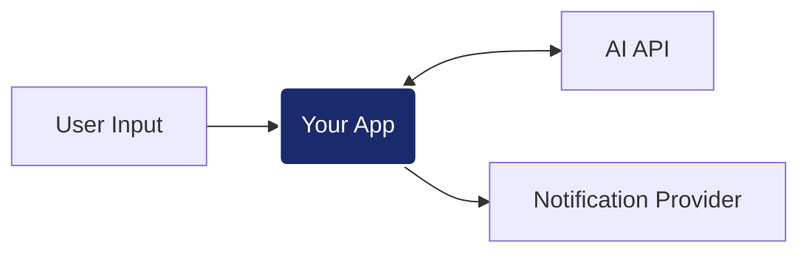

# AI Engineer Challenge: Intelligent Notification Service

## El Reto
Tu objetivo es implementar un servicio que procese entradas de lenguaje natural, extraiga información estructurada mediante un motor de IA y coordine el envío de notificaciones. La solución debe ser capaz de manejar la incertidumbre de los LLM (ruido en respuestas, formatos inconsistentes) y la latencia del procesamiento cognitivo.



---

## Contrato de API
Para que la suite de validación pueda ejecutar los tests, debes implementar estrictamente los siguientes endpoints en una instancia de **FastAPI** corriendo en el puerto `5000`.

### Requisitos de estructura
- **Punto de Entrada:** `app/main.py`
- **Instancia:** `app = FastAPI()`
- **Puerto local:** `localhost:5000`

### 1. Ingesta de Intenciones
- **POST** `/v1/requests`
- **Input:** `{"user_input": "Manda un mail a feda@test.com diciendo hola"}`
- **Output:** `201 Created` con `{"id": "string"}`

### 2. Procesamiento de Envío
- **POST** `/v1/requests/{id}/process`
- **Lógica esperada:**
    1. **Extracción:** Llamar a la IA en `localhost:3001/v1/ai/extract`.
    2. **Prompting:** Diseñar un `system prompt` para extraer: `{"to": "...", "message": "...", "type": "email|sms"}`.
    3. **Guardrails:** Implementar lógica para limpiar y validar la respuesta (quitar Markdown, corregir JSON mal formado, etc).
    4. **Notificación:** Si es válido, enviar a `localhost:3001/v1/notify`.
- **Output:** `200 OK` o `202 Accepted`

> **Nota sobre el prompt:** Para garantizar la estabilidad de los tests, el mock utiliza lógica interna para resolver la extracción. Sin embargo, la calidad y robustez de tus instrucciones (prompting) serán factores determinantes en la evaluación humana.

### 3. Consulta de Estado
- **GET** `/v1/requests/{id}`
- **Output:** `200 OK` con `{"id": "string", "status": "queued|processing|sent|failed"}`

---

## Integración con el Provider
El motor de IA y el servicio de notificaciones están disponibles en `localhost:3001`. Ambos requieren el encabezado de seguridad: `X-API-Key: test-dev-2026`.

- **Motor IA:** `/v1/ai/extract` (Esquema estándar de mensajes `system`/`user`).
- **Notificaciones:** `/v1/notify` (Esquema definido en los docs del provider).
- **Documentación:** Puedes consultar los Swagger Docs en `http://localhost:3001/docs`.

---

## Ejecución y Evaluación
1. **Levantar infraestructura:** `docker-compose up -d provider influxdb grafana`
2. **Tu aplicación:** `docker-compose up -d --build app`
3. **Validación (k6):** `docker-compose run --rm load-test`
4. **Resultados:** Visualiza el scorecard en tiempo real en [Grafana (localhost:3000)](http://localhost:3000/d/ia-performance-scorecard/)

---
*Se valorará la robustez frente a errores inesperados, la calidad del prompting y la arquitectura del pipeline de procesamiento.*

---

## Implementación (solution notes)

The original challenge text above is unchanged. This section describes the implemented solution. The full specification, design and task list are in [`openspec/changes/complete-readme-challenge`](openspec/changes/complete-readme-challenge/).

### Architecture

```text
POST /v1/requests              → validate → in-memory store (queued, not admitted) → 201 {id}
POST /v1/requests/{id}/process → atomic admission → bounded queue → 202 {id, status}
                                         │
                              32 lifespan-owned workers
                                         │
       AI /v1/ai/extract (system prompt + untouched user text, ≤2 attempts)
                                         │
       guardrails: unwrap → strict JSON → constrained repair → aliases → semantic validation
                                         │
       shared notification gate (≤50 per 10.1 s, 0.21 s spacing, shared 429 cooldown)
                                         │
       /v1/notify (≤3 attempts, resend only when provably safe) → sent | failed
GET /v1/requests/{id}          → {id, status}
```

| Module | Responsibility |
|---|---|
| `app/main.py` | Module-level `app = FastAPI()` plus a `create_app()` factory for isolated test instances; lifespan, three contract routes, `/health`, `/metrics`, sanitized 422s |
| `app/settings.py` | Validated environment-backed configuration and safety limits |
| `app/models.py` | Public schemas, statuses, immutable snapshots, internal failure codes |
| `app/store.py` | Records, atomic admission, conditional transitions, expiry, eviction, idempotency keys and counters |
| `app/extraction.py` | System prompt and deterministic normalizer/validator for noisy AI output |
| `app/provider_client.py` | Authenticated, size-bounded HTTP calls with typed, retry-aware errors |
| `app/pipeline.py` | Workers, retry budgets, notification gate, deadlines, graceful stop, structured logs |
| `app/metrics.py` | Prometheus text exposition rendered at scrape time, no client library |
| `app/smoke.py` | Live probe: create → process → poll every ID to a terminal state |

### API semantics

| Case | Response |
|---|---|
| Valid create | `201 {"id"}`; status `queued`; no upstream call |
| First process call | `202 {"id","status"}`; work runs in the background |
| Repeated process, still queued or processing | `202` with the current status; never enqueued twice |
| Repeated process, `sent` or `failed` | `200` with the terminal status; nothing is resent |
| Unknown or evicted ID | `404 {"detail":"request_not_found"}` |
| Invalid body (missing, non-string, blank, too long, extra fields, bad JSON) | `422` that never echoes input |
| Queue full, store full, stopping | `503` with `queue_full`, `store_full` or `shutting_down`; a rejected process call can be retried later |
| `GET /health` (extra, outside the contract) | `200 {"status":"ok"}` while accepting work; `503 {"status":"unavailable"}` when stopping or degraded; never calls the provider |
| Create with `Idempotency-Key` (optional, extra) | First use: `201 {"id"}`. Same key and body: the same `201 {"id"}` plus `Idempotent-Replayed: true`, with nothing new created (even when the store is full or stopping). Same key, different body: `422 {"detail":"idempotency_key_reused"}`. Key not 1–255 visible ASCII characters: `400 {"detail":"invalid_idempotency_key"}`. A key lives as long as its record; eviction frees it |
| `GET /metrics` (extra) | Prometheus text format: request gauges by status, queue depth/capacity, `notify_up`, outcome counters by failure code, AI and delivery attempts, provider dispatches and 429 pauses, replays, evictions and admission-to-terminal time. Labels are fixed codes only, never request content |

### Guardrails

- **Prompt:** a dedicated system message fixes the exact three-field schema and the `email|sms` channels. It requires the message to be copied verbatim, forbids inventing data, and treats user text as data rather than instructions. If information is missing, the model must reply `CANNOT_EXTRACT: <reason>`. The original input travels unchanged in a separate `user` message.
- **Normalizer:** handles all 16 provider variants. It accepts canonical JSON, the three alias sets, extra metadata, fenced or prose-wrapped JSON, the exact `...` truncation, single quotes and unquoted keys. It rejects missing fields, duplicate or conflicting aliases, multiple candidate objects, refusals, recipient/channel mismatches, bad recipients and oversized or deeply nested output. Repair is syntax-only: no `eval`, no global quote replacement, and no guessing of values from the user's text.
- **Retries:** at most 2 AI attempts in total. Only transport errors, 429/5xx and unparsable syntax are retried; a syntax retry adds a corrective system note. Refusals and semantic errors fail immediately. Notification gets at most 3 attempts, resending only after a 429 or a proven pre-send connection failure. 5xx responses, read/write timeouts and malformed receipts become `failed` (`delivery_unknown`) **without resend**, because the provider has no idempotency key. Notification retries never re-run extraction.

### Configuration

| Variable | Default |
|---|---|
| `PROVIDER_BASE_URL` / `PROVIDER_API_KEY` | `http://localhost:3001` / challenge dev key (never logged) |
| `NOTIFY_WORKERS` | 32 |
| `NOTIFY_QUEUE_CAPACITY` / `NOTIFY_RECORD_CAPACITY` | 4096 / 10000 |
| `NOTIFY_JOB_DEADLINE_SECONDS` / `NOTIFY_UNADMITTED_TTL_SECONDS` | 1800 / 1800 |
| `NOTIFY_SHUTDOWN_GRACE_SECONDS` | 10 |
| `NOTIFY_INPUT_MAX_CHARS` | 4096 |
| `NOTIFY_LOG_LEVEL` | `INFO` |

### Running the tests

The suite uses only the standard library (`unittest`) plus the pinned runtime dependencies. The default run needs no live provider, randomness or real long sleeps.

| Layer | Modules | Runs against |
|---|---|---|
| Unit | `test_settings_models`, `test_store`, `test_extraction`, `test_provider_client`, `test_metrics` | Pure logic; HTTP via `httpx.MockTransport` |
| Integration | `test_pipeline`, `test_api` | Real workers and lifespan; scripted provider |
| End-to-end (deterministic) | `test_end_to_end`, `test_smoke` | Full HTTP flow in process |
| Provider contract | `test_provider_contract` | The real `provider/responses.py` generator, seeded; skipped when `provider/` is absent |
| Live end-to-end (opt-in) | `test_live` | A running stack; skipped unless `LIVE_BASE_URL` is set |

```sh
python3.12 -m venv .venv && .venv/bin/pip install -r app/requirements.txt
PYTHONPATH=app .venv/bin/python -m unittest discover -s app/tests -v
# or inside the real image:
docker compose run --rm --no-deps app python -m unittest discover -s tests
# live tests and probe once the stack is up:
LIVE_BASE_URL=http://localhost:5000 PYTHONPATH=app .venv/bin/python -m unittest discover -s app/tests -p test_live.py -v
.venv/bin/python app/smoke.py --base-url http://localhost:5000 --timeout 120
```

CI (`.github/workflows/ci.yml`) runs the suite with a 95% branch-coverage floor. A second job runs the suite inside the app image and the live tests against the Compose stack.

> On macOS, AirPlay Receiver occupies port 5000. Either disable it, or publish the provider's port 5000 elsewhere through a local Compose override. Inside the Compose network nothing changes.

### Verification evidence (2026-10-27, Python 3.12.11, pinned dependencies)

- **Deterministic suite:** 186 tests pass on the host venv and inside the app image (contract and live tests skip there); 99% branch coverage of `app/` (`coverage` installed ad hoc, not a project dependency).
- **Provider contract:** 5,000 seeded draws from the real generator give exact payloads or terminal rejections only.
- **Live tests:** all 3 pass against the running Compose stack, including the idempotent replay and `/metrics`.
- **Live smoke** (5 requests against the real mock): 5/5 `sent`, at most 4.1 s to terminal.
- **k6 `load-test`** (unchanged script, 200 VUs, 40 s): 19,236/19,236 checks passed, 0% HTTP failures, avg 0.95 ms and p95 2.5 ms request latency. A rerun after adding idempotency keys and metrics (2026-10-28): 19,201/19,201 checks, 0% HTTP failures, p95 6.5 ms, with the stack already busy.
- **Delivery, observed separately from k6:** all 2,748 accepted requests reached a terminal state. 2,278 were `sent`. 470 were `failed`: 285 AI refusals and 185 invalid extractions with a missing `to`/`type`. That is 82.9% sent against the mock's 83.3% recoverable share. The run had 0 provider 429s, 0 failed notify attempts and 1.0 AI attempts per request. The backlog drained about 8 minutes after the load started, at about 5 notifications/s, which is the provider's ceiling.

### Known limitations

- Single process, in-memory state: a restart loses records and pending work, and multiple Uvicorn workers are unsupported (the rate limiter is per process).
- Exactly-once delivery cannot be guaranteed: an uncertain notification outcome is reported as `failed` instead of risking a duplicate.
- Throughput is bounded by the provider (50 notifications per 10 s), so a burst becomes a backlog. HTTP acceptance is not delivery.
- The mock lowercases input and takes the text after the last `:` as the message (`"cita a las 10:00"` becomes `"00"`). The application deliberately does not compensate with its own regex extraction.

### Production path (not implemented on purpose)

The challenge runs one container through one load test, so these were left out to keep the evaluated stack exactly as supplied. The code isolates each concern, so every change stays local:

| Need | Change | Touches |
|---|---|---|
| Survive restarts | Records in a database (e.g. Postgres) with the same conditional transitions (`UPDATE … WHERE status = …`) | `store.py` only; the pipeline already treats the store as the source of truth |
| Don't lose pending work | A durable queue (e.g. Redis Streams, SQS) with acknowledgement after `finish`; the existing tombstone check already makes redelivery harmless | The queue passed to `Pipeline`, plus a startup sweep for records left `processing` |
| Run several instances | Move the notification gate's window and cooldown to shared storage (e.g. Redis), so all instances together stay under 50 per 10 s | `NotificationGate` |
| Durable idempotency | Keep `Idempotency-Key` in the database with a unique index and a TTL, instead of tying it to in-memory records | `store.py` |
| Protect the API | Authentication (API keys or OAuth) and per-client rate limits in front of `/v1/*`; restrict `/metrics` to the scrape network | `main.py` or the ingress |
| Observability | Scrape `/metrics` from Prometheus; add tracing (e.g. OpenTelemetry) across the AI and notify calls | `main.py`, `provider_client.py` |
| Delivery truth | Ask the provider for idempotency keys or delivery lookups, so `delivery_unknown` can be resolved and safely retried | `provider_client.py`, `pipeline.py` |
